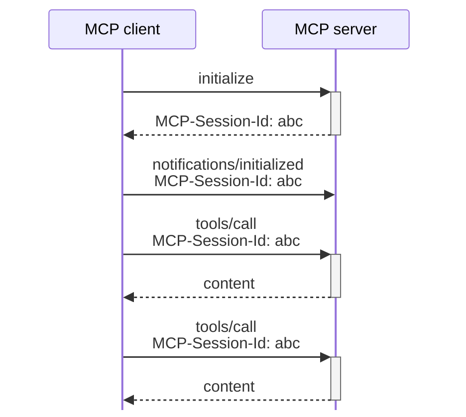

# What is a protocol-level session?

::content::

<dl class="space-y-8 text-xl leading-snug">

<dt class="font-semibold">セッション</dt>
<dd class="mt-3 ml-6">
複数のやり取りを関連づける 
範囲や単位
</dd>

<dt class="font-semibold">protocol-level session</dt>
<dd class="mt-3 ml-6">
プロトコルの仕様として 
定められたセッション
</dd>

<dt class="font-semibold">旧来のMCPでは</dt>
<dd class="mt-3 ml-6">
初期化でバージョンや対応機能を共有し 
後続のやり取りでも前提として使う
</dd>

</dl>

旧来のMCPにおける例

Streamable HTTPでセッションIDを使う場合

