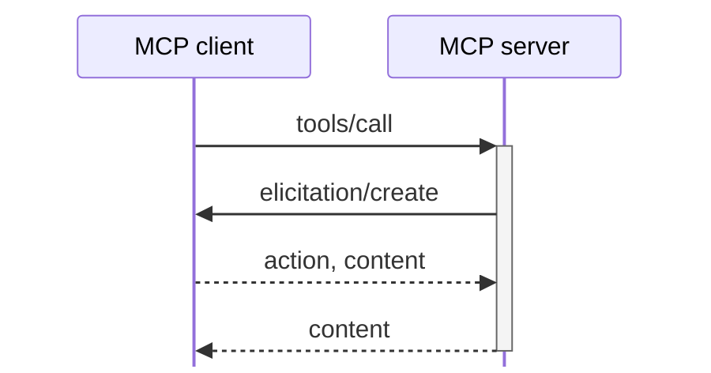
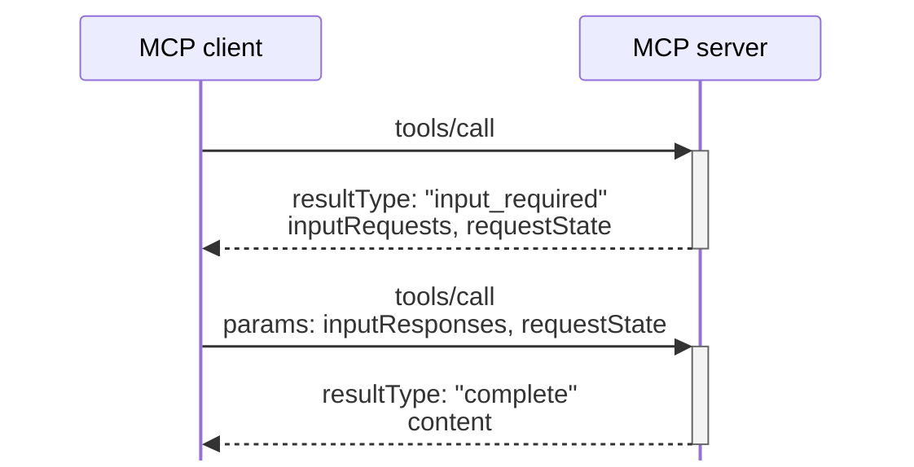

# intermediate stateはリクエスト間で引き継ぐ

Multi Round-Trip Requests（MRTR）：追加情報を含めてリクエストを再送する

### Before

### After

最初の<code>tools/call</code>へのレスポンスを待たせる

追加情報を含めて新しい<code>tools/call</code>で再送する

<code>inputRequests</code>：追加情報を得るための依頼

<code>inputResponses</code>：依頼へのレスポンス

<code>requestState</code>（optional）：途中の状態をそのまま返す

サーバーは追加情報の依頼をレスポンスに含め 
クライアントは追加情報を含めてリクエストを再送する

