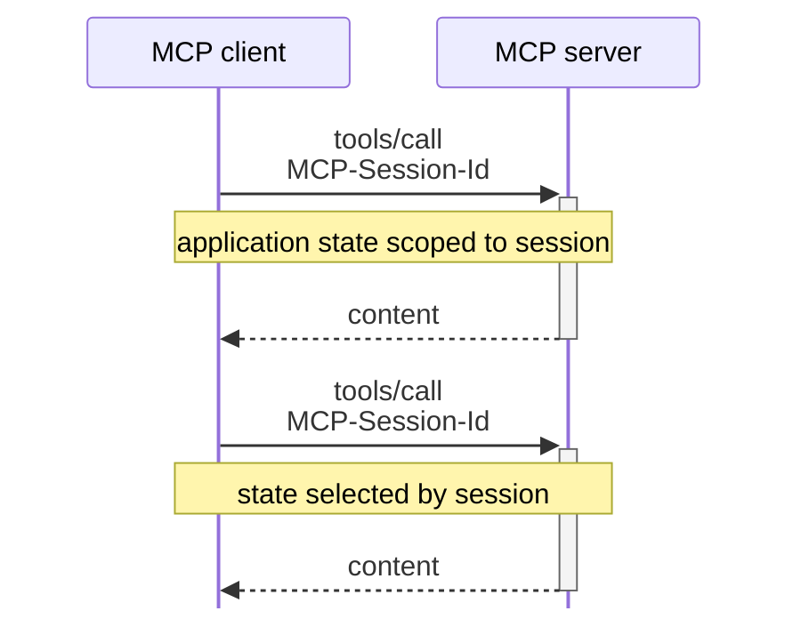
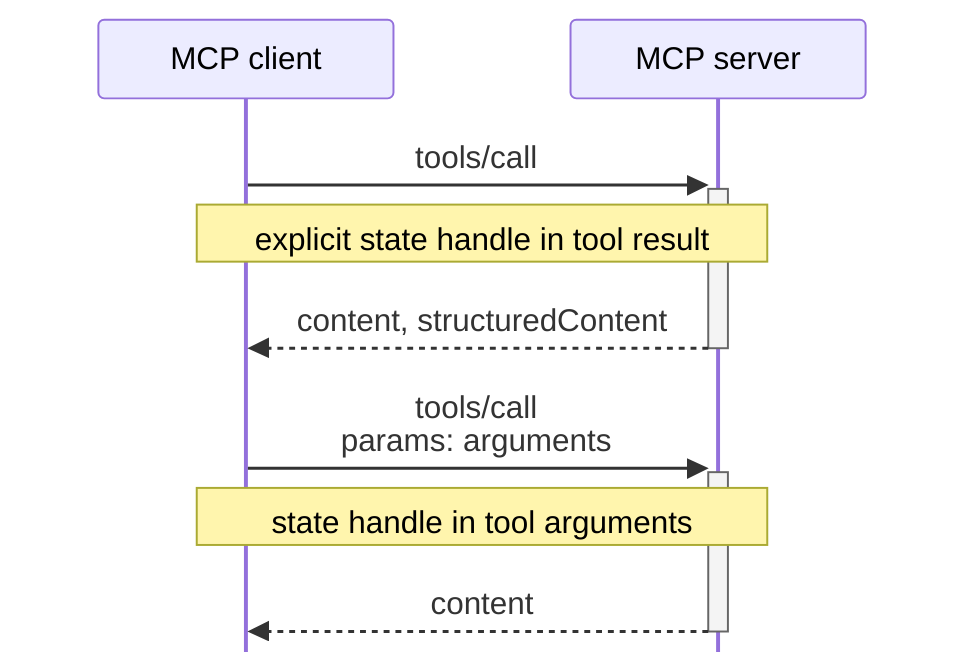

# application stateはexplicit state handleで参照する

::content::

explicit state handle：サーバーが管理するapplication stateを参照するための識別子

### Before

### After

アプリケーションの設計により セッションに状態をひもづける

handleの形式や有効期間は アプリケーション側で設計する

サーバーは状態を識別するhandleを返し 
クライアントは以降の呼び出しでそのhandleをtool argumentとして渡す

